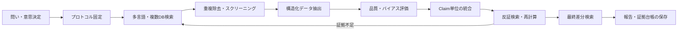
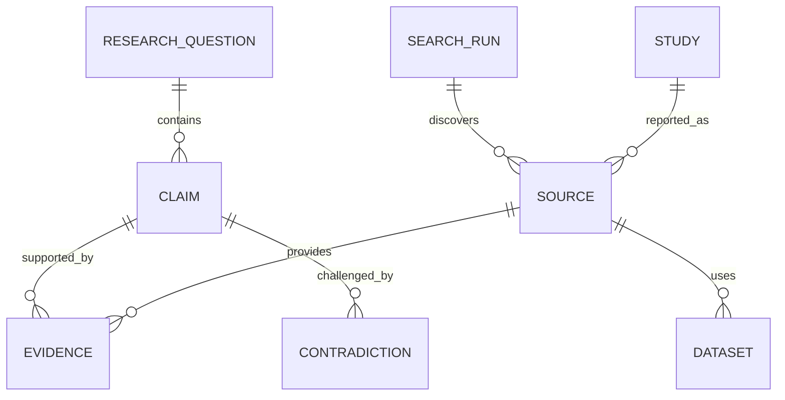
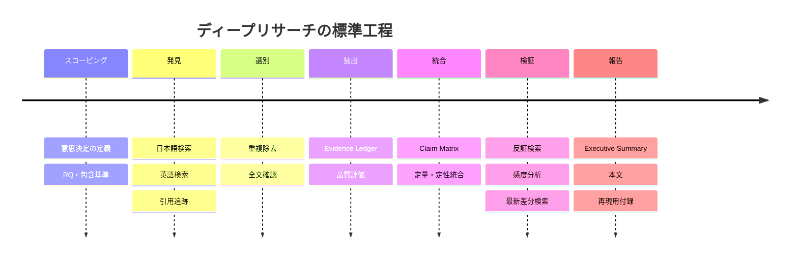
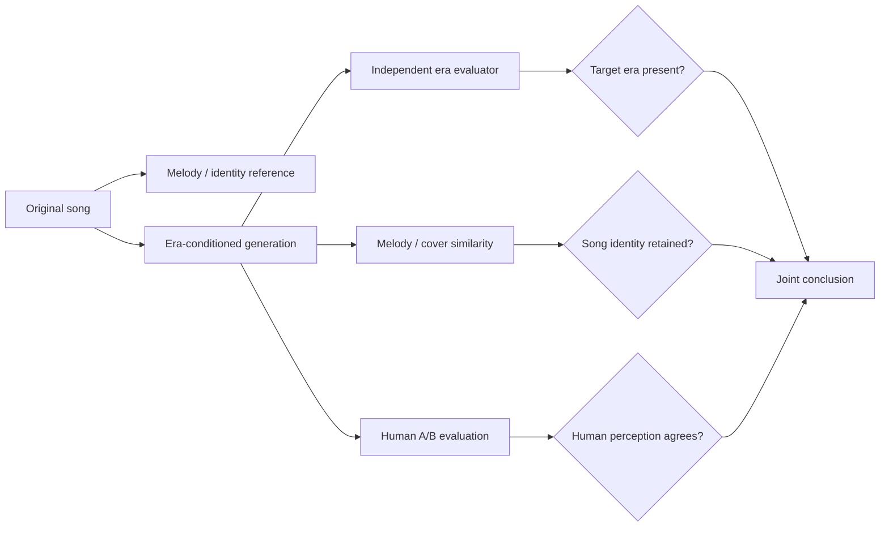

# 再利用可能なディープリサーチ設計・実務テンプレート

## エグゼクティブサマリー

良いディープリサーチは「大量の資料を集める作業」ではなく、**問い → 検索 → 選別 → 証拠抽出 → 品質評価 → 統合 → 反証 → 報告**を、第三者が追跡・再実行できる形で残すプロセスである。体系的レビューの報告にはPRISMA 2020のチェックリストとフロー図が有用で、検索自体はCochrane Handbookが推奨する「主要概念ごとに同義語をOR、概念間をAND、自由語と統制語彙を併用し、検索式・実行日を完全保存する」原則が汎用的に応用できる。citeturn6search2turn7search0

実務上もっとも重要なのは、**検索用の情報源と、結論を支える証拠を分けること**である。Google型検索、Crossref、CiNii Research、OpenAlex、Scopus/Web of Scienceなどは発見に強いが、最終的な主張は可能な限り原著論文、政府統計、法令・規制当局、標準規格、企業の法定・適時開示、原データ、公式リポジトリに戻って確認する。日本ではCiNii Research、J-STAGE/Jxiv、国立国会図書館サーチ、e-Stat/e-Gov、JPX/TDnetがこの一次情報チェーンの中核となる。citeturn1search1turn2search4turn0search5turn1search6turn15search4

成果物の中心は文章そのものではなく、各結論について「どの情報源の、どの箇所が、どの程度の確度で、それを支持または反証しているか」を記録した**Evidence Ledger（証拠台帳）**にする。この構造にすると、新論文・統計更新・規制変更が起きても、全調査をやり直さず差分更新できる。

AIは文献発見、重複候補、分類補助、構造化抽出には有効だが、証拠の最終判定者にはしない。たとえばRayyan自身もAI機能を意思決定支援として位置づけ、人間による検証を求めている。citeturn8search4

本報告の適用例には、アップロードされた研究案を利用し、**「音楽音声のどの部分から年代・リリース市場を識別でき、その特徴を年代条件付きカバー生成に使えるか」**を題材とする。これは、分類・因果的なコントロール・生成・評価・データバイアスを一つの調査で扱えるため、汎用テンプレートのテストケースとして適している。fileciteturn0file0

## 調査設計と実行方法

ディープリサーチの最初の成果物はレポートではなく、**1～2ページのプロトコル**にする。途中で問いが変わる「scope creep」を防ぐためである。

| 段階 | 実施内容 | 保存する成果物 | 完了条件 |
|---|---|---|---|
| スコーピング | 意思決定、RQ、対象、期間、地域、比較対象、評価指標を定義 | `protocol.md` | 「何をもって回答済みとするか」が明示されている |
| 検索 | 日本語・英語、複数DB、引用追跡、公式サイトを検索 | `search_log.csv` | 検索式、DB、日時、件数を保存 |
| 優先順位付け | 一次資料、レビュー、二次資料、未査読を区別 | `sources.csv` | 証拠レベルが付与済み |
| スクリーニング | 重複除去、タイトル・抄録、全文判定 | `screening.csv` | 除外理由まで追跡可能 |
| データ抽出 | 方法、データ、効果量、限界等を構造化 | `evidence.parquet` | 主張が原文箇所まで遡れる |
| 統合 | RQ/claim単位で一致・不一致を整理 | `claim_matrix.csv` | 根拠のない結論がない |
| 検証 | 反証検索、数値再計算、感度分析、最新版確認 | `validation.md` | 主要結論に反証テスト済み |
| 報告 | 結論、確度、限界、方法、付録を作成 | `report.qmd` | 第三者が検索・抽出を再現可能 |

Cochraneは、研究単位と論文単位を混同しないこと、同一研究に複数の報告があり得ること、訂正文や補足資料も重要であることを明示している。この原則は医学以外でも、プレプリント→会議論文→ジャーナル版、技術報告→製品版といった重複を二重計上しないために有効である。citeturn7search1

**スコープの最小テンプレート**は次のようにする。

```text
Decision:
  この調査結果を何の意思決定に使うか

Research questions:
  RQ1:
  RQ2:
  RQ3:

Population / Object:
Intervention / Technology / Exposure:
Comparator:
Outcomes / Metrics:
Geography:
Time window:
Languages:
Eligible evidence:
Exclusions:
Freshness requirement:
Stop rule:
```

医学以外ではPICOを無理に使う必要はない。「Entity–Mechanism–Comparator–Outcome–Context」程度に置き換えればよい。

**Evidence Ledger**は最低限、次のスキーマを持たせる。

```text
source_id
study_id
claim_id
title
authors
year
source_type
peer_review_status
population_or_dataset
sample_size
method
comparator
metric
reported_result
uncertainty
limitations
conflict_of_interest
evidence_locator
doi_or_identifier
version
accessed_at
quality_flags
analyst_interpretation
```

特に `reported_result` と `analyst_interpretation` は別列にする。これにより、**「著者が報告したこと」と「調査者がそこから推論したこと」**を混同しにくい。

検索から報告までの標準フローは次の通りである。



PRISMA 2020は27項目のチェックリストと改訂フロー図を提供しており、「何件見つけ、なぜ除外し、何件を最終統合したか」を報告する枠組みとして使える。一方、PRISMAは個々の研究そのものの品質を保証する道具ではないため、後述するリスク・オブ・バイアス評価とは分離する。citeturn6search2

## 情報源と検索戦略

### 推奨データベース

日本語の政策・産業・学術調査では、海外データベースだけに依存すると日本固有の資料を取りこぼす。逆に日本語DBだけでは国際的なSOTAや引用関係を見失いやすい。したがって、**日本語一次資料 + 国際学術DB + 分野別一次資料**の三層構造がよい。

| 情報源 | 最適な用途 | 長所 | 主な注意点 |
|---|---|---|---|
| **CiNii Research** | 日本の論文・研究成果の横断探索 | Crossref、JaLC、Jxiv、IRDB等を統合し、日本の研究探索の起点にしやすい。APIも利用可能。citeturn1search1turn1search7 | 原文・査読状況は元資料まで確認 |
| **J-STAGE / Jxiv** | 国内学会誌、会議録、日本発プレプリント | J-STAGEはJST運営で4,000超のジャーナル・会議録等を掲載。Jxivは国内の全分野プレプリント基盤。citeturn2search4turn2search11 | Jxivは未査読。Jxiv自身もその点を注意喚起している。citeturn2search3 |
| **国立国会図書館サーチ** | 書籍、報告書、歴史資料、灰色文献 | BibTeX、TSV、JSON等の出力とAPI/OAI-PMHがある。citeturn0search5turn0search12 | 学術論文専用DBではない |
| **e-Stat / e-Gov** | 日本政府統計、行政データ | e-Stat APIはXML/JSONによる機械取得を提供し、e-Gov Data Portalは政府オープンデータの入口となる。citeturn1search6turn1search9 | 定義変更・系列接続を必ず確認 |
| **PubMed** | 医学・生命科学 | 4,000万件超の引用・抄録を収録し、MeSHと自由語検索を組み合わせられる。citeturn3search0turn3search3 | 他分野には不十分 |
| **Crossref** | DOI・書誌メタデータ、引用候補の収集 | REST APIで書誌、資金、ライセンス、更新情報等を検索でき、登録不要の公開アクセスもある。citeturn3search1turn3search6 | 全文検索エンジンではない |
| **Scopus / Web of Science** | 引用追跡、網羅的な学術探索 | Scopusは大規模な抄録・引用DB、WoSは引用ネットワーク追跡に有用。citeturn14search0turn14search9 | 収録範囲・機能は契約依存 |
| **arXiv** | CS・AI等の最新技術 | APIが公開され、最新プレプリント発見に有効。citeturn5view2 | 査読前の版を最終証拠として扱わない |
| **TDnet / 企業IR** | 日本企業の業績・重要事象 | 上場会社の適時開示はTDnetで公表され、APIサービスでは過去データやPDF/XBRLも取得できる。citeturn15search4turn15search10 | 企業自身の主張と第三者評価を分ける |
| **ISO / Espacenet** | 標準・特許・技術ランドスケープ | ISO検索は規格番号・ICS等に対応し、Espacenetは特許ファミリー、引用、法的イベント等を確認できる。citeturn15search6turn14search15 | 特許の「記載」と実証済み性能は別物 |

J-STAGE Dataは論文関連データにDOIを付与して公開でき、ライセンスを明示する仕組みも持つため、日本の研究で「論文は見つかったがデータがない」という場合の確認先にもなる。citeturn2search6

### 検索式の作り方

最初から長大な検索式を一つ作るより、**概念ブロック**を作る。

```text
Concept A = 対象
Concept B = 手法・介入
Concept C = 成果・評価指標
Concept D = データセット・地域・期間
```

基本形は、

```text
(A1 OR A2 OR A3)
AND
(B1 OR B2 OR B3)
AND
(C1 OR C2)
```

である。Cochraneも、高感度検索には自由語と統制語彙を併用し、同一概念内をOR、異なる概念間をANDで組み合わせ、不必要な制約を避けることを推奨している。citeturn7search0

たとえば生成AIの企業導入効果を調べるなら、

```text
("generative AI" OR "large language model*" OR LLM)
AND
(productivity OR performance OR quality)
AND
(workplace OR firm OR employee)
```

日本語側では、

```text
("生成AI" OR "大規模言語モデル" OR LLM)
AND
(生産性 OR 業務効率 OR 品質)
AND
(企業 OR 従業員 OR 職場)
```

とし、さらに公式資料を探す場合には、

```text
site:go.jp "生成AI" 生産性
site:ac.jp "生成AI" 実証
site:jstage.jst.go.jp "生成AI" 労働
```

のような探索を追加する。

PubMedなら、自由語だけでなくMeSHを使えるため、概念ごとにMeSHとTitle/Abstract語を併記する。PubMedの公式ガイドはAutomatic Term Mapping、MeSH、フィールド指定などの検索機能を説明している。citeturn3search3

検索は一方向ではなく、次の順で反復する。

**Seed search → 用語辞書作成 → 高感度検索 → backward citation → forward citation → 著者/研究室検索 → データセット名検索 → 反証検索 → 最新差分検索**

特に最後の**反証検索**が重要である。たとえば「X improves Y」を調べたなら、

```text
X AND ("no effect" OR failure OR limitation OR replication)
X AND bias
X AND negative result
X AND "external validation"
```

も検索する。これによって、肯定的な論文だけが集まる確認バイアスを抑える。

## ツールと再現可能ワークフロー

ツールは「最も高機能なもの」ではなく、**証拠の由来を失わず次回更新できるもの**を選ぶ。

| 工程 | 推奨 | 用途・判断 |
|---|---|---|
| 文献管理 | **Zotero** | Browser Connectorで書誌・資料を保存し、Groupsで共同ライブラリを作れる。PDFからDOI等を使ったメタデータ取得にも対応。citeturn8search0turn8search1turn8search5 |
| スクリーニング | **Rayyan** | 重複整理、include/exclude/maybe、独立Blind判定、AI補助など。citeturn8search6turn8search3 |
| 大規模レビュー | **Covidence** | 全文判定、Risk of Bias、抽出・エクスポートを一つのワークフローで扱える。citeturn8search17 |
| 書誌取得 | **Crossref / CiNii / NDL / arXiv API** | 手作業コピーよりAPIを優先し、識別子を維持する。citeturn3search1turn1search7turn0search12turn5view2 |
| 分析 | **Python / R** | dedup、集計、統計、図表、品質チェック |
| データ版管理 | **DVC** | Gitと組み合わせてデータ、依存関係、実験結果を追跡し、キャッシュされた成果物を再構築できる。citeturn9search14turn9search0 |
| パイプライン | **Snakemake** | 入力→処理→出力をruleとして定義し、依存関係・並列処理を再現可能にする。citeturn10search0 |
| 執筆 | **Quarto** | コード実行と本文・図表を同じ計算文書にまとめる。citeturn11view0turn11view1 |
| CI | **GitHub Actions** | 更新検索・テスト・レポート生成を自動化し、成果物をartifactとして保存できる。citeturn9search7 |

スクレイピングは**最後の手段**にする。優先順位は、

> 公式API → OAI-PMH/RSS →公式CSV/JSON/XML export → 許可されたHTML取得 → 手動取得

とする。取得規約、著作権、ライセンスを確認し、リクエスト間隔を制御し、rawレスポンスを日時付きで保存する。Cochraneの検索指針も、情報取得時に著作権・ライセンス条件を守る必要性を明記している。citeturn7search0

再現可能なプロジェクトは、たとえば以下で十分である。

```text
research/
├── protocol/
│   └── protocol.md
├── queries/
│   └── search_log.csv
├── data/
│   ├── raw/
│   ├── interim/
│   └── processed/
│       └── evidence.parquet
├── refs/
│   └── library.bib
├── src/
│   ├── fetch.py
│   ├── clean.py
│   ├── extract.py
│   └── synthesize.py
├── report/
│   └── report.qmd
├── dvc.yaml
├── Snakefile
├── environment.lock
└── README.md
```

開始時のディレクトリ生成は一つのコマンドに固定できる。

```bash
mkdir -p research/{protocol,queries,data/{raw,interim,processed},refs,src,report} \
  && cd research \
  && git init \
  && dvc init
```

データモデルも先に定義すると後工程が安定する。



ここで `STUDY` と `SOURCE` を分離する点が重要である。同一実験のarXiv版、会議版、ジャーナル版を三つの独立証拠として数えないためである。

## 品質評価とバイアス対策

「査読済み」「有名誌」「引用数が多い」だけで品質を判断しない。最終的な各主張について、少なくとも以下を評価する。

| 評価軸 | 主な問い |
|---|---|
| 出典・権威性 | 一次資料か。誰が作成し、どのような利害があるか |
| 直接性 | 調べたいclaimを直接測定しているか、代理指標か |
| 研究設計 | 比較群、ランダム化、時系列、外部検証等は適切か |
| データ | 標本数、代表性、欠測、重複、selection biasはどうか |
| 測定 | ラベル・指標・センサー・評価者は妥当か |
| 統計 | 不確実性、効果量、多重比較、感度分析が示されているか |
| 再現可能性 | コード、データ、プロトコル、モデル版が残っているか |
| 新鮮さ | 現在も有効な版・法律・製品・データか |
| 利益相反 | 資金源・ベンダー・自己評価による方向性があり得るか |
| 独立整合性 | 独立した研究・データから再現されているか |

各軸を `Low concern / Some concern / High concern / Unknown` として保存する方が、恣意的に「品質82点」のような単一スコアを作るより情報を失いにくい。

医学・介入研究では専用の枠組みを使う。ROBINS-Iは非ランダム化介入研究について交絡、参加者選択、介入分類、欠測、アウトカム測定、報告選択など複数ドメインのバイアスを評価する。GRADEはエビデンス確実性をHigh/Moderate/Low/Very Lowに整理し、risk of bias、inconsistency、indirectness、imprecision、publication/dissemination biasなどを考慮する。これらは強力だが、ソフトウェアベンチマークや市場分析に形式だけを移植するのではなく、分野に合わせて評価軸を適応させるべきである。citeturn6search0turn13search3

実務では、次の五つの防御策が特に効く。

**プロトコル固定。** 検索前に主要RQ、包含・除外基準、主要評価指標を固定し、後から変えた場合は変更履歴を残す。

**独立判定。** 重要調査なら少なくともサンプルについて二人でスクリーニング・抽出を照合する。RayyanのBlind Modeは独立判定を支援する仕組みである。citeturn8search3

**言語・地域バイアスへの対処。** 日本のテーマなら英語だけでなく日本語で独立検索し、政府・学会・大学リポジトリ・業界団体も確認する。逆に日本語資料だけで「世界的SOTA」を論じない。

**反証マトリクス。** 各主張について支持証拠だけでなく、反対・無効果・条件付き結果を同じ表に載せる。

**更新日管理。** API、法律、統計、製品仕様、標準、ベンチマーク順位などは取得日とバージョンを記録し、提出直前に差分検索する。

証拠の最終表示は次の形式が有効である。

| Claim | 支持する主要証拠 | 反証・例外 | 品質上の懸念 | 結論確度 |
|---|---|---|---|---|
| C-01 | 独立した複数研究 | 小規模研究で無効果 | 対象集団が限定的 | 中～高 |
| C-02 | 単一ベンチマーク | 外部検証なし | dataset shift | 低 |
| C-03 | 政府統計＋原データ | 定義変更あり | 系列非連続 | 中 |

「証拠がない」と「無効果を示す証拠がある」も必ず区別する。

## 成果物テンプレート・工数・トラブル対処

### 最終レポート

再利用しやすい最終構成は以下である。

```text
Title

Executive Summary
  問い
  Bottom line
  最重要の3～5 findings
  結論確度
  最大の注意点
  意思決定への含意

Scope and Definitions
  RQ
  用語
  対象範囲
  除外範囲

Methods
  データベース
  検索式
  期間
  選別
  品質評価

Evidence
  RQごとの結果
  比較表
  数値・図

Contradictions and Uncertainty
  一致しない研究
  感度分析
  未解決点

Implications
  何がかなり確実か
  何が暫定的か
  次の意思決定

Limitations

Appendix
  全検索式
  除外理由
  Evidence Ledger
  データ・コード・バージョン
```

エグゼクティブサマリーは「本文の要約」よりも**意思決定用の独立した一枚**として書く。

> **Question:** 何を判断する調査か  
> **Bottom line:** 現時点で最も支持される結論  
> **Evidence:** 最重要の証拠三点  
> **Confidence:** High / Medium / Low と理由  
> **Caveat:** 結論を覆し得る最大の不確実性  
> **Implication:** したがって何をする／まだしないべきか

### 図表テンプレート

時間軸を追うテーマでは、出来事と「公開日」を混同しない。ニュース、規制、製品などでは特に**event_date**と**publication_date**を別フィールドにする。



定量研究なら「研究ごとの効果量と信頼区間」、技術調査なら「性能対コスト」「性能対データ規模」、市場調査なら「時系列＋制度変更点」のように、**問いに直結する軸を一枚の図にする**。単に論文数を棒グラフにしても、意思決定にはほとんど寄与しない。

### 工数の目安

以下は文献的な標準値ではなく、再利用のための**実務上の計画値**である。分野、全文アクセス、二重スクリーニング、メタ分析の有無によって大きく変動する。

| 規模 | 典型的スコープ | 最終的に精読する資料 | 人時の目安 | カレンダー期間 | 成果物 |
|---|---|---:|---:|---:|---|
| **小** | RQ 1～2、狭い技術比較 | 20～60 | 16～40時間 | 2～5営業日 | 5～10ページ＋Evidence Ledger |
| **中** | RQ 3～6、複数データ源 | 60～200 | 80～240時間 | 2～6週間 | 15～30ページ＋再現コード |
| **大** | 複数領域・多数のサブRQ | 200～1,000+ | 400～2,000+時間 | 2～6か月以上 | systematic/evidence map級 |

最初の10～20%をスコーピングと検索式改善に使った方が、後半で数百件の無関係資料を読むより安い。大規模調査では二名以上のスクリーニング、専門家による方法論レビュー、統計・データ担当を分ける。

### よくある失敗

| 症状 | 原因 | 修正 |
|---|---|---|
| 数千件ヒットするが回答にならない | テーマ名だけで検索 | `claim + metric + dataset/method` に分解 |
| 有名論文しか残らない | citation/popularity bias | 最新、反証、外部検証、負の結果を独立検索 |
| 同じ研究を複数回数える | preprint・会議・雑誌版の重複 | DOI、著者、データ、study IDでクラスタ化 |
| 数値が論文間で矛盾 | population、split、metricが違う | 同一条件だけ比較し、異質性を表に残す |
| AI要約と論文が違う | 二次要約を証拠にした | claimごとに原文locatorへ戻る |
| スクレイピングが突然壊れる | HTML構造/API変更 | API優先、raw snapshot、schema/versionを保存 |
| 最新情報が古い結論を覆す | 調査開始時点で検索終了 | 提出直前にdelta search |
| 「データなし」を「効果なし」と書く | absence of evidenceの誤読 | evidence gapとして別分類 |
| ベンチマーク性能が実運用で再現しない | distribution shift | 外部データ、時間外データ、地域外データで検証 |
| 企業資料だけで市場を評価 | source incentive | 規制当局、顧客、競合、第三者データで三角測量 |

## 適用例：音楽の年代・市場推定と年代条件付きカバー生成

アップロードされた研究案は、音楽の**リリース年代・リリース市場をどの音響要素から判別できるか**を調べ、mix、vocal、accompanimentを比較し、さらに安定した年代特徴が見つかった場合に、同じ曲を異なる年代風に生成しながらメロディ保持を検証する計画である。また、release marketはアーティストの出身地ではなくリリース地として扱う点が明確に区別されている。fileciteturn0file0

この研究を上記テンプレートに入れると、次のような**Claim Map**になる。

| RQ | 調べる主張 | 主な一次証拠 | 必須コントロール | 成功指標 |
|---|---|---|---|---|
| Era | 音声から年代情報を抽出できる | 年代ラベル付き音源、原著モデル論文 | genre、artist、codec、remaster | macro-F1、MAE、隣接年代誤差 |
| Market | release marketに音響情報がある | release metadata＋音源 | language、artist origin、genre | macro-F1、confusion |
| Stem | 情報源がvocal/accompanimentで異なる | 同一曲のpaired stems | separator artifact、bleed | paired Δ performance |
| Bias | モデルが本当に年代・市場を学んだか | controls/counterfactuals | sampling、language、production | controlled Δ |
| Generation | 年代条件でstyleを変えられる | melody-conditioned generator | 元曲identity、prompt leakage | target-era score |
| Preservation | melody/song identityが保持される | 原音と生成音 | tempo/key変化 | chroma/CSI＋human |
| Validity | era evaluatorが自己循環していないか | 独立encoder＋human test | train/eval leakage | evaluator agreement |

出発点となるDiscogs-VI原著は、約190万version・約34.8万cliqueのmetadata datasetを構築し、公式YouTube音源へのマッピングでは約49.3万version・約9.8万cliqueを得たと報告している。公開リポジトリはDiscogs-VIメタデータとYouTube ID等を提供する一方、音声そのものを再配布していないため、**メタデータの利用可能性と音源利用可能性を別々に記録する**必要がある。citeturn16view1turn12search2

エンコーダ探索では、たとえばMERTは音楽特化の自己教師あり表現として95M～330Mパラメータを検討し、14のmusic-understanding taskで評価されている。MuQはMel-RVQを使った自己教師ありモデルで、公開0.9K時間での学習から160K時間超へのスケーリングを検討している。したがって、「年代分類に最適」という先入観を置くのではなく、**MERT/MuQ等の凍結埋め込みを同一split・同一probeで比較する**ことが調査上も実験上も重要になる。citeturn16view2turn16view3

生成側ではMusicGen原著がテキストまたはmelodic featuresによる条件付けを実装し、自動評価と人間評価を行っている。そのため、「年代」という新しい制御属性を調査する場合も、既存のmelody conditioningを内容保持の基準として使い、年代制御だけを追加要因として分離する設計が可能である。citeturn16view0

このテーマに対する初期検索式は次のように分ける。

```text
# 年代推定
("music era" OR "release year" OR decade)
AND
(audio classification OR regression OR "music representation")

# 市場・地域
("release country" OR "release market" OR geographic OR region)
AND music
AND (audio OR classification)

# stem attribution
("source separation" OR stem OR vocals OR accompaniment)
AND
(classification OR attribution OR bias)
AND music

# shortcut/confound
music
AND
("shortcut learning" OR confound* OR "artist effect"
 OR "album effect" OR language OR mastering)
AND classification

# 生成
music
AND
("melody conditioned" OR cover OR restyl* OR "style transfer")
AND
(era OR decade OR vintage OR production)

# 評価
("cover song identification" OR chroma OR "melody similarity")
AND
("music generation" OR "style transfer")
```

さらに日本語でも、

```text
音楽 AND (年代 OR リリース年) AND (分類 OR 推定)
音楽 AND (地域 OR 発売国 OR リリース国) AND 音響
音楽生成 AND (年代 OR 時代 OR スタイル変換) AND メロディ
```

を独立検索する。ただしこの特定テーマの最新MIR・生成モデルは英語一次文献が中心になるため、日本語検索は国内の関連研究・学位論文・データ利用事例の発見に位置付ける。

この調査で特に危険なのは、「年代分類器の精度が高い → 年代固有の音楽スタイルを学習した」と直接推論することである。年代はgenre、録音機材、mastering、codec、artist、言語、流通市場などと相関し得るため、**stemごとの比較、artist-disjoint split、language control、production control、reissue/remaster確認**を別々のclaimとして検証する必要がある。これはアップロードされた研究案が意図している「演唱言語、編曲・録音特徴、データ分布バイアスのどれを学習しているか」を分解することにも対応する。fileciteturn0file0

生成評価も一つの年代分類器だけで終えない。年代probeを生成モデルと同じ表現・データで学習すると循環評価になり得るため、少なくとも、



のように、**target-style presence**と**content preservation**を別軸で評価し、人間評価を第三の独立軸として加える。MusicGen自身も自動評価だけでなくhuman studyを実施しているため、この多軸設計は既存の生成研究の評価思想とも整合する。citeturn16view0

この適用例で最終的に作るべき表は、単なる「論文一覧」ではなく次のようなギャップ表である。

| 調査対象 | 文献で既に確立していること | 未解決点 | この研究で検証できること |
|---|---|---|---|
| 音楽表現 | MERT、MuQ等の強力な汎用音楽表現が存在する。citeturn16view2turn16view3 | era/market情報がどの層・stemにあるか | 同一linear probeで公平比較 |
| 大規模version data | Discogs-VIには大規模なversion/clique metadataがある。citeturn16view1 | course subset外でera/marketをどう再構築するか | release metadataとの再結合 |
| Stem attribution | 本プロジェクトの中心仮説 | separation artifactとの識別 | mix/vocal/accompのpaired ablation |
| Market | release marketとartist originは概念的に別 | 音響だけで何が残るか | language control後の残差性能 |
| Generation | Melody-conditioned MusicGenが利用可能。citeturn16view0 | decadeを安定した制御変数にできるか | era-conditioned accompaniment |
| Evaluation | 自動＋humanの多面的評価が可能 | era probeの循環性 | 独立probe＋identity metric＋A/B |

この題材に本テンプレートを適用する場合、**最初の研究成果はモデル学習ではなく、「Era」「Market」「Stem attribution」「Bias」「Generation」「Evaluation」という六つのclaim familyに既存研究を割り当て、各claimについて一次資料・データ・評価指標・未解決点をEvidence Ledger化すること**になる。そこまでできれば、文献調査は単なる背景説明ではなく、どの実験を実施すれば最も情報価値が高いかを直接決める設計資料になる。